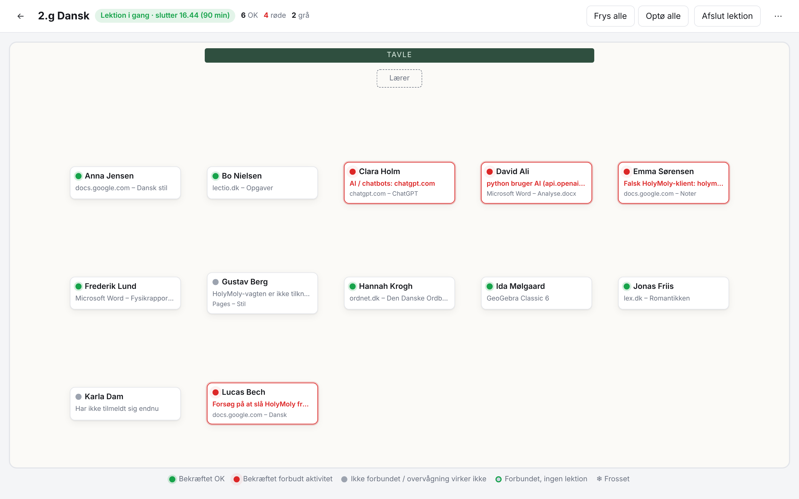
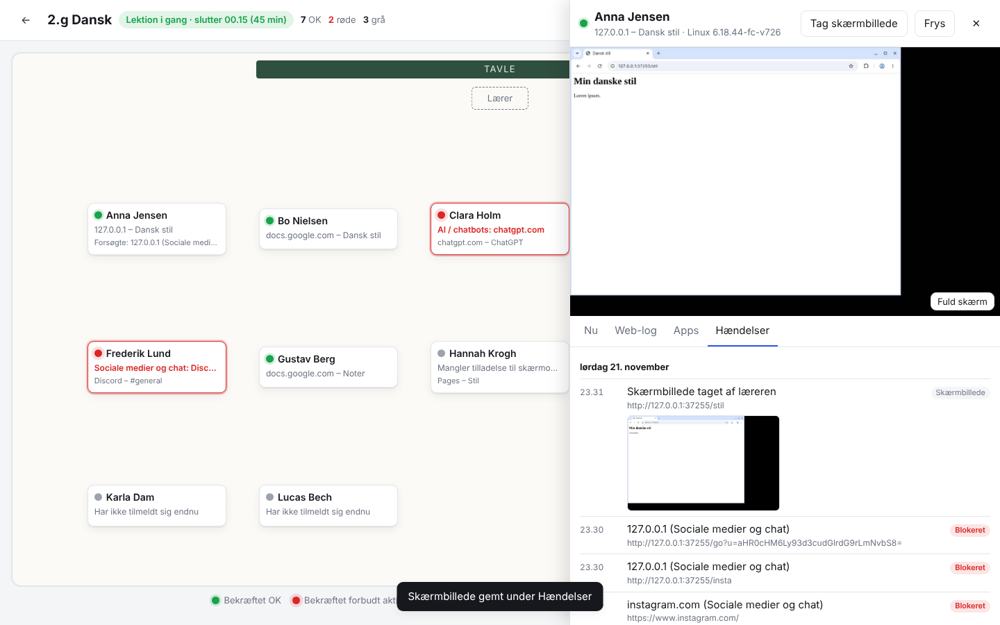

# Holybeta – offentlig beta af HolyMoly

**Holybeta er testudgaven til skolen. Den er gratis og bliver ikke solgt.** Her afprøver vi HolyMoly i et par klasser, før noget bliver et produkt. Den officielle udvikling foregår i HolyMoly-repoet.

| | Holybeta (dette repo) | HolyMoly |
| --- | --- | --- |
| Til | Test på vores egen skole | Den officielle udgave, der udvikles til et produkt |
| Pris | Gratis, ingen licens | Licens pr. elev |
| Login | Lærer: brugernavn + adgangskode. Elev: klassekode + navn + egen kode | E-mail, to-faktor og Unilogin |
| Server | Skolens egen (fx Proxmox), se [docs/PROXMOX.md](docs/PROXMOX.md) | Hostet |

Serveren starter selv i enkel tilstand (`server/edition.json`). Kom i gang med [docs/ENKEL.md](docs/ENKEL.md).

**Før rigtige elever:** skolens ledelse skal have sagt ja, skolens DPO skal have set databehandleraftalen, og skolen skal drive serveren. Indtil da er det en testserver, og beviserne siger "Testserver – må ikke bruges til bedømmelse". Ikke til prøver eller eksamen.

Fejl og idéer: opret et issue her i repoet.

---

## Om HolyMoly

**Elevernes bevis på, at deres tekst ikke er skrevet med AI.**

Læreren ser klassen som en tegning af klasseværelset med en lampe pr. elev og – under navnet – hvad eleven er inde på lige nu (fx "docs.google.com – Dansk stil" eller "Microsoft Word – Analyse.docx"). Der er kun tre farver, og ingen af dem er et gæt:

| Lampe | Betyder |
|---|---|
| 🟢 Grøn | **Bekræftet OK**: HolyMoly har læst adressen på den aktive fane / navnet på programmet, og det er tilladt. Det står under navnet. |
| 🔴 Rød | **Bekræftet forbudt**: adressen på den aktive fane eller programmet i forgrunden er forbudt (AI, sociale medier, spil …). Skærmbillede gemmes som dokumentation. |
| ⚪ Grå | **Ikke forbundet**: appen kører ikke, intet svar fra appen i 20 sek., skærmen kan ikke optages, eller en nødvendig tilladelse mangler (fx skærmoptagelse på Mac). Årsagen står under navnet. |
| ◯ Grøn ring | Forbundet, men lektionen er ikke startet – intet overvåges |

Bordene viser **ingen billeder** af elevernes skærme. Først når læreren klikker på en elev, ses skærmen live (eleven får vist "Din lærer kigger på din skærm lige nu"). Derfra kan læreren **tage skærmbilleder** (gemmes under elevens hændelser), se **åbne faner**, **kørende programmer**, **komplet web-log** og **hændelser med skærmbilleder**, samt **fryse** én eller alle skærme med en besked. Ukendte programmer kan **blokeres eller tillades for hele klassen med ét klik**.

### Hvorfor ingen "måske"-tilstand?

En lampe der siger "måske" giver plads til at snyde imens. I stedet fjerner HolyMoly de tvetydige situationer:

- **Adressen læses direkte fra browseren** – på Windows fra adresselinjen (UI Automation), på Mac fra Safari/Chrome/Edge/Brave/Arc via AppleScript. Det virker også i inkognito og andre browserprofiler.
- **Browsere HolyMoly ikke kan se ind i, lukkes**: browsere uden HolyMoly-udvidelsen (efter 8 sek. – udvidelsen findes til Chrome, Edge, Brave, Opera, Vivaldi og Firefox), ukendte browsere og vinduer hvor adressen ikke kan læses. Eleven får en besked om hvorfor.
- **Rød kræver hårde beviser**: adressen eller procesnavnet. En side der bare *hedder* "ChatGPT", et Word-dokument om Instagram eller en Wikipedia-side om TikTok giver aldrig rød (der er tests for netop det).
- **Blokerede forsøg** logges og vises som tekst under navnet ("Forsøgte: chatgpt.com"), men farver ikke lampen – forsøget lykkedes jo ikke.
- **Skærmoptagelsen tjekkes hvert 15. sekund** lokalt på elevens computer (uden at billedet sendes). Virker den ikke, bliver eleven grå.






## Grundprincip: kun i lektionen, kun når appen er åben

Overvågning og blokering kører kun når **læreren har trykket "Start lektion"**. Lektionen stopper automatisk efter den valgte tid. HolyMoly-appen og vagten starter med computeren, men uden for en lektion sender de kun "jeg er her" – ingen skærm, ingen faner, ingen programmer – så læreren kan ikke kigge med i weekenden. Eleven kan altid se i appen, om en lektion kører.

**Under lektionen kan appen ikke afsluttes** (Afslut-knappen er væk, Cmd+Q/Alt+F4 virker ikke – kun når computeren slukkes). Dræber eleven den alligevel via Jobliste/Aktivitetsovervågning, bliver lampen grå med tidspunkt ("Forbindelsen blev afbrudt 10.32"), og det står i loggen. Blokeringen i browseren fortsætter til lektionen slutter.

## HolyMoly-vagten: beviset kommer ikke fra elevens program

Elev-appen kører som eleven selv, så en elev med programmeringsevner kunne i princippet skrive sin egen "app", der sender grøn status. Derfor er der en **vagt** ved siden af appen:

- Vagten kører som **SYSTEM** (Windows, planlagt opgave) / **root** (Mac, LaunchDaemon) – den kan ikke lukkes eller ændres af eleven.
- Den har sin egen nøgle: på Windows i computerens **TPM-chip**, på Mac en fil kun root kan læse. Hver besked til serveren er **signeret** (ECDSA P-256), og gamle beskeder kan ikke genafspilles.
- Vagten taler **direkte med serveren** – ikke gennem elev-appen. Serveren sender selv lektion, blokeringsliste og hvad der skal lukkes.
- Vagten ser selv: kørende programmer, hvilke programmer der taler med AI-tjenester, **hvilket program der er forbundet til HolyMoly** (den ægte app = rigtig sti + rigtig signatur), og om nogen piller ved hosts-filen, browser-politikkerne eller opgaverne.
- **Serveren afgør farven.** Windows og Mac uden en parret vagt er aldrig grønne ("HolyMoly-vagten er ikke tilknyttet"), en vagt der ikke svarer i 25 sek. giver grå, og et falsk program forbundet til HolyMoly, AI fra et program, et forbudt program der ikke lader sig lukke, eller forsøg på at slå HolyMoly fra giver rød.
- Har vagten selv en intern fejl, bliver eleven grå med fejlen som årsag (aldrig grøn), og fejlen står i loggen.

Parring sker automatisk: når appen logger ind, giver serveren en engangskode (15 min.), som appen afleverer til vagten. Får eleven en ny kode (ny computer), gælder den gamle vagt-nøgle ikke længere.

## Dele

```
server/      Node.js-server + lærer-dashboard (ingen build-step, kun én afhængighed: ws)
agent/       Elev-appen (Electron) til Windows, macOS og Linux
extension/   Browser-udvidelse (Chrome, Edge, Brave, Opera, Vivaldi – Manifest V3)
shared/      Regelmotoren (blokeringslister + genkendelse), brugt af alle tre
deploy/      Docker + Caddy (automatisk HTTPS), regel-override, politikker til skole-PC'er
test/        Unit-, integrations- og ende-til-ende-tests
```

### Hvordan blokeringen virker (lag på lag)

1. **Netværk** (udvidelsen, `declarativeNetRequest`): ~600 domæner i kategorierne AI, sociale medier, spil, video, lektiehjælp, proxy/VPN og fjernstyring blokeres før siden overhovedet hentes – også i indlejrede rammer og API-kald.
2. **Adressen afkodes**: Google Translate-proxyer (`chatgpt-com.translate.goog`, `translate.google.com/translate?u=…`), webarkiver, adresser gemt i parametre og **base64-kodede** adresser i proxyer fanges.
3. **Indholdet genkendes** (content script i alle sider og rammer): en kopi af fx Instagram eller ChatGPT på et ukendt domæne genkendes på `og:site_name`, sidetitel og kendetegn i siden – og indholdet fjernes.
4. **"Unblocked games" og proxyer** på gratis hosting (Google Sites, GitHub Pages, Vercel …) fanges på ord i adressen.
5. **Google AI-oversigter og AI-tilstand** slås fra (`udm=14`), og Bing Copilot, Duck.ai m.fl. blokeres.
6. **Programmer**: spil, AI-apps, Discord, fjernstyring (AnyDesk, TeamViewer …) og virtuelle maskiner lukkes automatisk (kan slås fra pr. klasse). Omdøbte programmer genkendes på originalt filnavn (Windows) / bundle-id (Mac).
7. **AI inde i andre programmer (Windows)**: HolyMoly ser hvilke programmer der har åbne forbindelser, og til hvilke værtsnavne (via Windows' egen DNS-cache). Taler Word, Python eller et ukendt program med en AI-tjeneste (fx Copilot, `api.openai.com`, Gemini-API'et), bliver eleven rød: "Word bruger AI (copilot.microsoft.com)". Lagring (OneDrive, iCloud, Google Drive) er ikke AI og giver ikke rød. En IP-adresse tæller kun, hvis *alle* navne på den er AI-tjenester, så delte CDN-adresser aldrig giver falsk rød. Alt sker lokalt – ingen API'er, ingen regning.
8. **AI-knapper i tilladte sider** (Gemini i Google Docs/Gmail, Copilot i Word Online, Notion AI …) skjules af udvidelsen.
9. **Snyd med browseren**: Adressen læses fra browseren selv, uafhængigt af udvidelsen – for alle synlige browservinduer, også på skærm 2 og i inkognito. Browsere uden udvidelse og vinduer der ikke kan ses ind i, lukkes. På Mac tjekkes alle faner i Safari/Chrome/Edge, og forbudte sider sendes til en blokeringsside.
10. **Indholdsgenkendelse kræver to beviser** (fx sidens navn *og* kendetegn i siden), så almindelige sider ikke blokeres ved en fejl.
11. **Prøvetilstand**: kun de sider læreren har tilladt (plus login-sider og netprøver.dk) kan åbnes. Alt andet blokeres, og en ikke-tilladt side i forgrunden giver rød.

Listerne opdateres centralt: læg en `rules-override.json` i serverens datamappe (se `deploy/rules-override.example.json`), så sendes de nye regler til alle elever inden for 30 sekunder – uden ny installation. Læreren kan også selv tilføje/undtage sider og programmer pr. klasse.

### Dårligt internet

- Blokeringen sker lokalt på elevens computer og virker også uden net.
- Hændelser lægges i kø og sendes når forbindelsen er tilbage (intet tabes).
- Der sendes kun tekst (status ca. hvert 5. sekund), indtil læreren klikker på en elev. Live-skærmen sender så et nyt billede først når læreren har modtaget det forrige og tilpasser kvaliteten til forbindelsen – dårligt net giver færre billeder, aldrig en kø.
- Automatisk genforbindelse med backoff. Alt går over almindelig HTTPS (port 443), så det virker bag skolens firewall.

## Hostet HolyMoly – licens til skoler

HolyMoly kan køre som én hostet tjeneste med mange skoler (`LICENSING=1`). Det omfatter:

- **Forside med priser** på `/`. Vilkår, privatlivspolitik og databehandleraftale ligger på `/vilkaar`, `/privatliv` og `/databehandleraftale`, og elev-appen kan hentes på `/hent`.
- **Opret konto** (`/opret`): lærerens navn, arbejds-e-mail, adgangskode og skolens navn. E-mailen bekræftes via et link, og to-faktor sættes op med en godkendelses-app og 10 reservekoder.
  - "Glemt adgangskode" virker.
  - Logger læreren ind med **Unilogin**, viser STIL sin egen loginvælger (Unilogin, MitID eller skolens lokale login). Så springes HolyMolys to-faktor over.
- **Skole** (`/skole`):
  - administratoren inviterer kolleger på e-mail, styrer roller og kan nulstille en kollegas to-faktor,
  - administratoren bestiller licensen med antal elever, CVR og EAN eller faktura-mail.
- **Licens**: 30 dages gratis prøveperiode, derefter licens pr. elev pr. år. Er licensen udløbet, kan skolen se og eksportere alt, men ikke starte nye lektioner.
- **Administration** (`/admin`, kun `PLATFORM_ADMINS`): skoler, bestillinger, aktivering af licenser og omsætning.
- **Konto** (`/konto`): navn, adgangskode, to-faktor, tema og "Slet min konto".

Den praktiske tjekliste til at sælge (firma, hosting, SMTP, Unilogin hos STIL, jura og fakturering med EAN) står i **[docs/SALG.md](docs/SALG.md)**.

## Kom i gang

### 1. Server (IT-ansvarlig)

Kræver en server/VM med Docker og et domæne der peger på den:

```bash
cp deploy/.env.example deploy/.env   # udfyld domæne, PUBLIC_URL, SMTP og licens (se docs/SALG.md)
```

```bash
docker compose -f deploy/docker-compose.yml --env-file deploy/.env up -d
```

Caddy henter selv et HTTPS-certifikat. Lærere opretter sig på `https://<domæne>/opret`.

Uden Docker: `cd server && npm ci && npm start` (Node 22.13+), bag en HTTPS-proxy med `TRUST_PROXY=1`.

Skolens egen server (uden licens): sæt `LICENSING=0`. Sæt også `TEACHER_SIGNUP_CODE`, hvis lærere skal bruge en skolekode for at oprette sig.

| Miljøvariabel | Standard | |
|---|---|---|
| `LICENSING` | `0` (`1` i Docker) | Skoler, prøveperiode og licens (hostet HolyMoly) |
| `TRIAL_DAYS`, `PRICE_PER_STUDENT`, `PRICE_MINIMUM` | 30 / 129 / 2500 | Prøveperiode og priser (kr. ekskl. moms) |
| `REQUIRE_2FA` | `0` (`1` i Docker) | To-faktor kræves ved login med e-mail |
| `SIGNUP` | `open` | `closed`: kun med invitation |
| `SMTP_URL`, `MAIL_FROM` | – | E-mail. Uden `SMTP_URL` skrives mails i loggen og i `data/outbox/` |
| `VERIFY_EMAIL` | `1` når SMTP er sat | E-mailen skal bekræftes |
| `PLATFORM_ADMINS`, `SALES_EMAIL` | – | Jeres administratorer (`/admin`) og hvem der får besked om nye skoler og bestillinger |
| `COMPANY_NAME`, `COMPANY_CVR`, `COMPANY_EMAIL`, `COMPANY_ADDRESS`, `HOSTING_PROVIDER` | – | Vises på hjemmesiden og i juraen |
| `TEACHER_SIGNUP_CODE` | – | Skolekode lærere skal bruge for at oprette sig (skolens egen server) |
| `LOG_RETENTION_DAYS` | 30 | Log, skærmbilleder og lampernes tidslinje slettes automatisk herefter |
| `PURGE_AFTER_DAYS` | 90 | Kun med licens: skolens data slettes så mange dage efter, at prøveperiode og licens er udløbet. Administratorerne varsles 30 og 7 dage før (0 = aldrig) |
| `SECURITY_CONTACT` | `COMPANY_EMAIL` | Hvor sikkerhedsfejl meldes – vises i `/.well-known/security.txt` (RFC 9116) |
| `SESSION_MAX_HOURS` | 12 | Lærerens login holder højst så mange timer, uanset aktivitet (1–24) |
| `MIN_AGENT_VERSION` | – | Ældre elev-apps får ingen lektion og vises grå "Skal opdatere HolyMoly" |
| `MIN_EXTENSION_VERSION` | – | Ældre browser-udvidelser giver "Browser-udvidelsen skal opdateres" hos eleven |
| `AGENT_DOWNLOAD_URL` | – | Link til elev-appen, vises i dashboardet |
| `DATA_DIR` | `server/data` | SQLite-database, skærmbilleder, regel-override |
| `UNILOGIN_ISSUER`, `UNILOGIN_CLIENT_ID`, `UNILOGIN_CLIENT_SECRET`, `UNILOGIN_REDIRECT_URI` | – | Slår UNI-Login til (OpenID Connect via STIL). Se `deploy/.env.example` og afsnittet *UNI-Login* |
| `PUBLIC_URL` | – | Serverens offentlige adresse – står på skrive-beviser |
| `REQUIRE_GUARD` | `1` | Windows/Mac skal have en parret HolyMoly-vagt for at kunne blive grønne. Sæt kun til `0` under test |

### 2. Elev-app og udvidelse

1. Sæt serverens adresse i GitHub: *Settings → Variables → `HM_SERVER_URL`* (fx `https://holymoly.minskole.dk`).
2. Push et tag (`git tag v1.0.0 && git push --tags`). GitHub Actions bygger installere til Windows (`.exe`), macOS (`.dmg`) og Linux (`.AppImage`/`.deb`) og en zip af udvidelsen, og lægger dem under *Releases*.
3. Byg udvidelserne med `node scripts/build-extensions.js` (Chromium + Firefox) og udgiv dem i Chrome Web Store, Edge Add-ons og Firefox Add-ons (kan være "unlisted"), og indsæt links + udvidelses-id i `agent/config.json` (`extensionLinks`, `extensionIds`). Med `extensionIds` udfyldt accepterer appen kun jeres egen udvidelse.
4. Kodesignering: uden certifikat viser Windows SmartScreen og macOS Gatekeeper en advarsel. Tilføj `CSC_LINK`/`CSC_KEY_PASSWORD` som secrets for at signere (macOS kræver også notarisering).

**Skolens serveradresse i elev-appen** (uden at bygge appen om):
- IT kan sætte den ved installationen: `HolyMoly-Setup.exe /S /SERVER=https://holymoly.minskole.dk`. Den gemmes i `ProgramData\HolyMoly\server.txt`, som kun administratorer kan ændre (Mac: `/Library/Application Support/HolyMoly/server.txt`).
- Ellers spørger appen om adressen første gang. Vagten (SYSTEM/root) gemmer den, og derefter kan kun en administrator ændre den.
- En adresse, der er indbygget med `HM_SERVER_URL` (https) i build-workflowet, bruges, når ingen af delene er sat.

**Windows: Smart App Control.** Windows 11 med Smart App Control slået til starter ikke usignerede programmer. Til elevcomputere skal installationsprogrammet derfor signeres med et kodesigneringscertifikat (se docs/SALG.md).

**Serveren som "pak ud og kør" (Windows):** `HolyMoly-Server-Windows.zip` fra en release (eller `node scripts/build-server-win.js`). Dobbeltklik på *Start HolyMoly.cmd*. Til en rigtig klasse skal serveren have en HTTPS-adresse.

### 3. I klassen

1. Opret klassen og indsæt elevnavne (ét pr. linje, fx fra Lectio). Hver elev får en kode, som kan udskrives.
2. Klassen får en **klassekode**. Eleven installerer appen, skriver klassekoden og logger ind med UNI-Login (eller skriver sit navn) – og dukker op i klasseværelset. Appen viser, hvad der ellers mangler (fx browser-udvidelsen).
3. Træk bordene på plads (*⋯ → Rediger klasseværelse*).
4. Tryk **Start lektion**.

## Prøv det lokalt (demo)

```bash
npm --prefix server install
```

```bash
npm run demo
```

Åbn http://localhost:8080 og log ind med `demo@holymoly.dk` / `demo-kodeord`. Demoen starter en rigtig server med klassen "2.g Dansk", hvor 12 simulerede elever (med simulerede, signerende vagter) viser alle tilstande: grøn, ChatGPT, Python der bruger AI, falsk HolyMoly-klient, Mac uden vagt, vagt der holder op med at svare, et spil der ikke kan lukkes, forsøg på at slå HolyMoly fra og en elev der ikke er tilmeldt.

## Unilogin (UNI-Login)

Login-siden har to faner: **Lærer** og **Elev**. Begge kan logge ind med UNI-Login, når skolen har tilsluttet HolyMoly hos STIL:

1. Skolen/udbyderen registreres i STIL's udbyderregister og anmoder om **Unilogin Broker** på *tilslutning.stil.dk* (kræver MitID Erhverv).
2. Tjenesten sættes op på *udbyderportal.stil.dk* med redirect-adressen `https://<domæne>/api/auth/unilogin/callback`.
3. Udfyld `UNILOGIN_*` i `deploy/.env` (se `deploy/.env.example`) og genstart.

Det sker der så:
- **Lærere** logger ind med UNI-Login. Nye lærer-konti kræver en lærer-rolle i UNI-Login (`UNILOGIN_ROLE_CLAIM`/`UNILOGIN_TEACHER_ROLES`). Lærere med e-mail-konto kan tilknytte UNI-Login under *Indstillinger*.
- **Elever** logger ind med UNI-Login i appen, efter de har skrevet klassekoden. Navnet kommer fra UNI-Login, og samme elev på en ny computer genkendes. På hjemmesiden kan eleven se, hvilke klasser den er tilmeldt.
- Sikkerhed: Authorization Code Flow med PKCE, engangs-state og nonce, og id-tokenets signatur, udsteder, modtager og udløb tjekkes (`server/src/oidc.js`, testet i `test/unilogin.test.js` mod en simuleret udbyder).

Uden UNI-Login logger lærere ind med e-mail, og elever tilmelder sig med klassekode + navn.

## Skriv i HolyMoly (skrive-bevis)

**Afleveringer:** Læreren opretter en aflevering under ⋯ → *Afleveringer* (titel, opgaveformulering, frist). Eleverne ser den i HolyMoly-appen ("Se afleveringer" eller skrivevinduets knap *Afleveringer*). De kan trykke *Skriv besvarelse* eller vedhæfte et dokument, de allerede har afsluttet. Læreren ser, hvem der har afleveret, og hvilke afleveringer der har fluebenet **✓ Tastet i HolyMoly – intet indsat**.

**Skriveøkt (skriv hjemme):** Har læreren sat flueben ved *Må skrives hjemme*, kan eleven trykke *Skriv hjemme* uden for timen. Så er kun elevens egen computer i lektion (overvågning og blokering), og kun mens skrivevinduet er åbent. Økten varer højst 3 timer og slutter senest ved fristen. Den står ikke i klassens lektionsrapport. Word-filer er skrivebeskyttede og har fluebenet, koden og tjek-linket i sidefoden.

Eleven trykker **Skriv dokument** i appen under en lektion og får en simpel Word-agtig editor (`agent/renderer/write.*`, `agent/src/writer.js`):

- Indsæt, træk-og-slip og tekst der sendes i store klumper (fx fra et "autotyper"-program) blokeres og tælles.
- Appen måler skriveforløbet: tastede og slettede tegn, tempo (tegn/sek.) og hvor jævnt tasterne kommer.
- Dokumentet gemmes hos serveren hvert 5. sekund. **Serveren noterer selv elevens lampe** ved hver gemning og tjekker selv, at teksten ikke vokser hurtigere, end et menneske kan skrive.
- Ved **Afslut dokument** vurderer serveren forløbet (`server/src/docs.js`) og udsteder et **skrive-bevis** signeret med Ed25519, hvis: teksten er skrevet under en lektion, ingen rød lampe, fuld overvågning (højst 10 %/3 min. grå), al tekst er tastet, menneskeligt tempo, og ingen tydelige AI-spor i teksten (fx "som en AI-sprogmodel", Markdown fra en chat). Ellers får eleven og læreren begrundelsen.
- Beviset kan tjekkes af alle på `/bevis/<id>` – også om en kopi af teksten er uændret (SHA-256 i browseren). Word-filen (.docx, `shared/doc.js`) har beviset nederst.
- Grænse (står på beviset): det kan ikke udelukke, at teksten er skrevet af efter en anden skærm eller et papir. HolyMoly gætter ikke på, om en tekst "lyder som AI" – det kan ikke gøres uden falske anklager.

Sæt `PUBLIC_URL` (fx `https://holymoly.minskole.dk`) så adressen står på beviserne.

## Hjemmeside og demo på GitHub Pages

`npm run pages` bygger `site/` og workflowet `.github/workflows/pages.yml` udgiver den ved hvert push til standard-grenen. Den indeholder:

- forsiden med priser (`index.html`),
- vilkår, privatliv, databehandleraftale og hent-side,
- `demo.html`: det rigtige lærer-dashboard med en simuleret klasse. Det kører helt i browseren og bruger adresser som `#klasse-1` og `#skole`.

Sæt repo-variablen `HOLYMOLY_APP_URL`, så "Prøv gratis" og "Log ind" går til den hostede tjeneste.

Slå det til én gang: *Settings → Pages → Build and deployment → Source: GitHub Actions*. Bemærk: GitHub Pages på et **privat** repo kræver GitHub Pro/Team.

GitHub Pages kan kun levere statiske filer. Hjemmesiden og demoen kører derfor konstant og gratis dér, men selve HolyMoly-serveren (login, klasser, elev-appens forbindelse, databasen) skal køre på en server – se [docs/PROXMOX.md](docs/PROXMOX.md) (egen server) og [docs/ENKEL.md](docs/ENKEL.md). Når den kører, sættes `HOLYMOLY_APP_URL` til dens adresse.

**Når repoet bliver offentligt:**

1. *Settings → General → Default branch*: vælg `beta`, så besøgende ser skolens udgave, og siden bygges fra den.
2. *Settings → Pages → Source*: vælg *GitHub Actions*.
3. *Actions → GitHub Pages (demo) → Run workflow*. Siden ligger derefter på `https://<bruger>.github.io/HolyMoly/`.

## Udvikling

```bash
npm --prefix server install
```

```bash
npm --prefix agent install
```

```bash
npm test          # unit + integration
```

```bash
npm run e2e       # Linux: server + rigtig Electron-app + Chromium med udvidelsen + dashboard under Xvfb
```

```bash
npm run server    # http://localhost:8080
```

```bash
HM_SERVER_URL=http://localhost:8080 npm run agent
```

Udvidelsen indlæses under udvikling via `chrome://extensions` → *Udviklertilstand* → *Indlæs upakket* → mappen `extension/`. Efter ændringer i `shared/rules.js`: kør `npm run sync`.

## Mac (MacBooks)

**Netværksfilter** (`macos/`): en macOS-systemudvidelse der under lektionen blokerer AI-tjenester og forbudte sider for *alle* programmer (også Safari, Word og Pages) og melder AI-forbindelser, så eleven bliver rød. Den skal signeres med skolens Apple Developer-konto – se [macos/README.md](macos/README.md). Bygges og tjekkes automatisk på en Mac i GitHub Actions ved hvert push.

Første gang skal eleven give HolyMoly tre tilladelser (appen viser knapper der åbner de rigtige indstillinger):

1. **Skærmoptagelse** – så læreren kan se skærmen og tage skærmbilleder
2. **Hjælpefunktioner** – til at se det aktive vindue
3. **Automatisering** af Safari/Chrome/Edge – til at læse adressen på den aktive fane

Mangler én af dem, er eleven **grå** hos læreren med årsagen skrevet ud ("Mangler tilladelse til skærmoptagelse"), indtil den er givet. På skole-administrerede Macs kan de gives automatisk med en PPPC-profil (se `deploy/managed/README.md`).

## Virtuelle skriveborde og låst computer

- **Frys og Gennemgang følger med**, hvis eleven skifter virtuelt skrivebord (Win+Ctrl+→, Opgavevisning, fire fingre på touchpad). Appen opdager det hvert sekund og åbner skærmen igen på det nye skrivebord. Læreren får en hændelse. På Mac vises skærmen på alle Spaces.
- **Overvågningen ser alle skriveborde**: browservinduer på andre virtuelle skriveborde tælles med, ligesom vinduer på skærm 2.
- **Låst computer eller *Skift bruger***: HolyMoly kan ikke se en anden brugers session, så eleven bliver grå med årsagen "Computeren er låst eller skiftet til en anden bruger". Vagtens blokering (hosts-filen) gælder alle brugere på computeren.

## Hvad HolyMoly ikke kan se – og hvad I gør ved det

- **Apple Intelligence på selve Mac'en**: en del af Apples skriveværktøjer kører lokalt uden netværk og kan derfor ikke ses af netværksfilteret (vinduet fanges dog). På skole-administrerede Macs kan det slås fra med MDM (`allowWritingTools`, `allowExternalIntelligenceIntegrations`).
- **AI-endepunkter og AI-knapper ændrer sig**: Microsoft og Google flytter rundt på adresser og knapper. Listerne (`aiEndpoints`, `aiUi` i `shared/rules.js`) opdateres centralt via `rules-override.json` og bør afprøves på rigtige maskiner før brug.
- **En anden enhed** (telefon, en vens computer) ses ikke – det er rummet læreren holder øje med.
- **Den eneste vej ud er at lukke HolyMoly** (via Jobliste/Aktivitetsovervågning – Afslut-knappen findes ikke i lektionen). Så er eleven grå = ikke på. Alt andet (anden browser, inkognito, anden profil, omdøbt program, virtuel maskine, falsk server, ændrede programfiler, debugging) er enten lukket, blokeret eller gør eleven rød.
- **Windows-delen** (adresselinje via UI Automation, frys, lukning af programmer) er skrevet til Windows 10/11, men den automatiske E2E-test kører på Linux. Test den på en rigtig Windows-PC og en MacBook før første rigtige lektion.

## Dokumenter

- [Lærervejledning (1 side)](docs/LAERERVEJLEDNING.md) – også som hjælpeside i dashboardet
- [Funktioner og udviklingsplan](docs/FUNKTIONER.md)
- [Juridisk tjekliste + tekst til elever/forældre](docs/JURA.md)
- [Sælg HolyMoly som licens: tjekliste](docs/SALG.md)
- [Mac-netværksfilter: opsætning med Apple-konto](macos/README.md)

## Persondata (GDPR)

Elever er ofte under 18, og skærmovervågning er behandling af personoplysninger. Før brug skal skolen/kommunen have:

- et **behandlingsgrundlag** og en **databehandleraftale** med den der hoster serveren,
- **information til elever og forældre** om hvad der registreres, hvornår og hvor længe,
- en vurdering af om der skal laves en **konsekvensanalyse (DPIA)**.

HolyMoly er designet til dataminimering: intet registreres uden for lektionen, skærmen ses kun når læreren klikker (eleven får besked), alle lærerhandlinger logges med navn, log og skærmbilleder slettes automatisk efter `LOG_RETENTION_DAYS`, og en lærer kan kun se sine egne klasser. Se [docs/JURA.md](docs/JURA.md).

## Sikkerhed

- Lærer-login med scrypt-hashede adgangskoder, HttpOnly/SameSite=Strict-cookies, rate-limiting på login og elevkoder, CSRF-tjek på oprindelse.
- Klassekoden (8 tegn) kan fornyes og lukkes for tilmelding; nye elever logges i hændelserne. Med UNI-Login kommer elevens navn fra UNI-Login og kan ikke forfalskes. Koder til "ny computer" er engangskoder (udløber efter 14 dage). Appen får et langt tilfældigt token, som serveren kun gemmer som hash og appen gemmer krypteret med styresystemets nøglering.
- En elev kan kun sende data for sig selv, og en lærer kan kun se egne klasser (testet).
- Dashboardet har streng CSP og indsætter aldrig elevdata som HTML. CSV-eksport er beskyttet mod formel-injektion.
- Adgang til elever tjekkes altid i databasen (aldrig i en cache), og slettede id'er genbruges ikke.
- Elev-appen kan ikke sende skærmbilleder af sig selv (kun efter lærerens anmodning eller en overtrædelse) og kan ikke skrive i lærer-logbogen. Grænser gælder pr. elev pr. lektion, så genforbindelser ikke nulstiller dem.
- Broen til browser-udvidelsen tjekker *hvilken proces* der forbinder (Windows: Get-NetTCPConnection, Mac/Linux: lsof). Kun rigtige browsere accepteres, og browsernavnet tages fra processen. Har et andet program taget HolyMolys port, bliver eleven rød. Kun den rigtige app kan afslutte blokeringen i browseren før tid (hemmelig token pr. lektion).
- Mac-netværksfilteret undtager kun kode signeret med skolens eget Team ID, og enhver ændring af dets regler fra et andet program giver rød.
- Der er lavet et uafhængigt sikkerhedseftersyn. Alle fund er rettet og har regressionstests (`test/server.test.js`, `test/bridge.test.js`, `test/macfilter.test.js`).

- **Egen klient**: En elev der skriver sit eget program og forbinder det til HolyMoly, bliver afsløret af vagten (forkert sti/signatur = rød). Uden vagt bliver Windows og Mac aldrig grønne.

**Den grænse der er tilbage (ærligt):** Vagtens parringskode går gennem elev-appen, som kører som eleven selv. Et forberedt script med elevens egen token kan derfor i princippet nå at parre en *falsk* vagt, før den rigtige gør det (ved første tilmelding, eller når eleven får en ny kode). HolyMoly gør det svært og synligt: koden fornyes ikke ved hver forbindelse, og prøver den rigtige vagt også at bruge koden, bliver eleven rød ("To forskellige HolyMoly-vagter …") – uanset hvem der kom først. Det eneste der lukker det helt, er skole-administrerede computere (MDM/Intune/Jamf) eller TPM-attestering, hvor computeren selv beviser, at nøglen ligger i dens TPM-chip (se `deploy/managed/README.md`). Skrive-beviset kan desuden ikke se, om en tekst er skrevet af efter en telefon eller et papir – det står på beviset.
- Elev-appen: Electron med `contextIsolation`, `sandbox`, uden `nodeIntegration`, og kræver HTTPS til serveren. Electron-fuses: ingen `--inspect`/`ELECTRON_RUN_AS_NODE`/`NODE_OPTIONS`, asar-integritetstjek, kun indlæsning fra asar. Serveradressen kan ikke ændres via miljøvariabler i den færdige app. Broen til udvidelsen lytter kun på `127.0.0.1` og kun for browser-udvidelser (og kun jeres, når `extensionIds` er sat).
